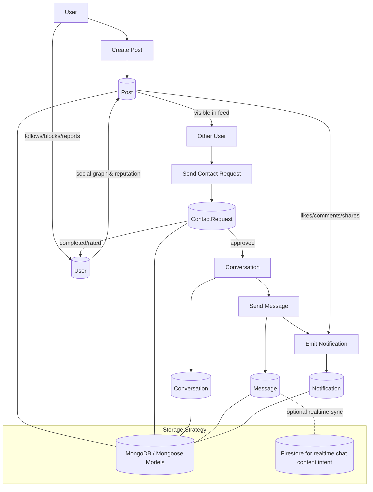

# MyCircle Database Design Mind Map

This diagram summarizes the MongoDB-backed models in the server and how they connect around the core marketplace workflow.

## Mind Map

```mermaid
mindmap
  root((MyCircle DB Design))
    User
      Identity
        googleId
        email
        passwordHash / passwordSalt
      Profile
        displayName
        avatar
        bio
        location
        skills
      Social Graph
        followers
        following
        blockedUsers
      Reputation
        rating
        reviews
        reputation.trustScore
        reputation.isVerified
      Activity
        stats.totalPosts
        stats.activePosts
        isOnline
        lastSeenAt
    Post
      Ownership
        user -> User
      Marketplace Data
        type
        itemCategory
        title
        description
        price / budgetMin / budgetMax
        location
        locationCoords
      Lifecycle
        status
        isActive
        expiresAt
        duration
      Engagement
        likes -> User[]
        comments
        shares
        views
      Exchange
        acceptsBarter
        exchangePreference
        barterPreferences
    ContactRequest
      Linkage
        post -> Post
        requester -> User
        recipient -> User
        conversationId -> Conversation
      Lifecycle
        status
        createdAt
        acceptedAt
        completedAt
        expiresAt
      Trust
        ratings
        completionMarkedBy
    Conversation
      Participants
        participants -> User[]
      Context
        postId -> Post
        lastMessage -> Message
      Lifecycle
        isActive
        deletedBy
        updatedAt
        expiresAt
    Message
      Threading
        conversationId -> Conversation
        sender -> User
        postId -> Post
      Delivery
        status
        readBy
        isAutoMessage
      Retention
        createdAt
        expiresAt
    Notification
      Audience
        recipient -> User
        sender -> User
      Content
        type
        title
        message
        link
      References
        relatedId
        conversationId -> Conversation
```

## Flow Chart



## Relationship Summary

- `User` is the hub for identity, social graph, reputation, and ownership of most activity.
- `Post` belongs to a single `User` and drives discovery, contact requests, messages, and notifications.
- `ContactRequest` bridges `User` and `Post`, then optionally creates a `Conversation` when accepted.
- `Conversation` groups participants around a post and points to the latest `Message`.
- `Message` belongs to a `Conversation`, is authored by a `User`, and can optionally be tied back to a `Post`.
- `Notification` is a cross-cutting event layer for requests, approvals, comments, likes, messages, and system events.

## Notes

- The server models show MongoDB schemas for all core entities.
- The chat layer is documented as hybrid: the codebase keeps a `Message` model in MongoDB, while the system documentation also references Firestore for realtime messaging support.